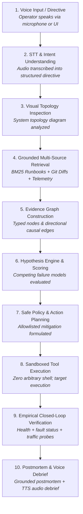
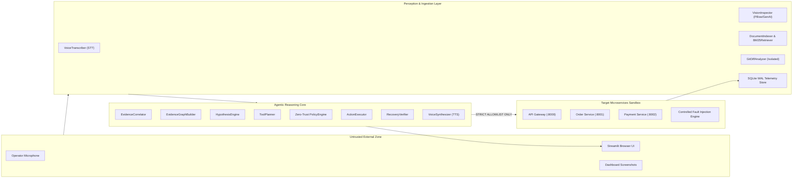

# ChaosPilot 🚀
### Agentic Multimodal SRE Agent for Autonomous Incident Diagnosis & Safe Recovery

> **Hackathon Theme:** *"The Agentic Era: Supercharging RAG with Vision and Voice"*  
> **Core Loop:** `Voice Directive` ➔ `Intent Understanding` ➔ `Vision / Topology Inspection` ➔ `Grounded Multi-Source RAG` ➔ `Directional Evidence Graph` ➔ `Hypothesis Evaluation` ➔ `Zero-Trust Policy & Action Planning` ➔ `Sandboxed Tool Execution` ➔ `Empirical Closed-Loop Verification` ➔ `Spoken Voice Debrief (TTS)`  
> **Technology Stack:** Real 3-Tier FastAPI Microservices · SQLite Write-Ahead Log (WAL) Telemetry · BM25 Okapi Grounded RAG · Isolated Git Forensics · Multimodal Perception (Voice STT/TTS & Structural Vision) · Directional Evidence Graph · Streamlit Operator Console · 118 Automated Regression Tests

---

## Table of Contents
1. [Executive Summary & Problem Statement](#1-executive-summary--problem-statement)
2. [ChaosPilot Core Loop & Workflow](#2-chaospilot-core-loop--workflow)
3. [System Architecture & Trust Boundaries](#3-system-architecture--trust-boundaries)
4. [Deterministic Outage Scenario & Fault Propagation](#4-deterministic-outage-scenario--fault-propagation)
5. [Complete Codebase & Line-by-Line Architecture Walkthrough](#5-complete-codebase--line-by-line-architecture-walkthrough)
   - [5.1 Microservices & Sandbox (`services/`, `sandbox/`)](#51-microservices--sandbox-services-sandbox)
   - [5.2 Telemetry & Traffic Ingestion (`telemetry/`)](#52-telemetry--traffic-ingestion-telemetry)
   - [5.3 Grounded Knowledge & BM25 Retrieval (`rag/`, `knowledge/`)](#53-grounded-knowledge--bm25-retrieval-rag-knowledge)
   - [5.4 Isolated Git Forensics (`git_ops/`)](#54-isolated-git-forensics-git_ops)
   - [5.5 Multimodal Perception Layer (`multimodal/`)](#55-multimodal-perception-layer-multimodal)
   - [5.6 Agentic Incident Reasoning Core (`agent/`)](#56-agentic-incident-reasoning-core-agent)
   - [5.7 Directional Evidence Graph & Grounded Claims (`agent/evidence_graph.py`)](#57-directional-evidence-graph--grounded-claims-agentevidence_graphpy)
   - [5.8 Multimodal Operator Console (`app/streamlit_app.py`)](#58-multimodal-operator-console-appstreamlit_apppy)
   - [5.9 Quantitative Evaluation Benchmark (`evaluation/`)](#59-quantitative-evaluation-benchmark-evaluation)
   - [5.10 Unified CLI Controller (`manage.py`)](#510-unified-cli-controller-managepy)
6. [The Resolution Invariant & Safety Guardrails](#6-the-resolution-invariant--safety-guardrails)
7. [Progressive Baseline Evaluation Matrix (Configs A–D)](#7-progressive-baseline-evaluation-matrix-configs-ad)
8. [Quickstart, Demo Scripts & CLI Instructions](#8-quickstart-demo-scripts--cli-instructions)
9. [Automated Regression Test Suite](#9-automated-regression-test-suite)
10. [Limitations, Disclosures & Production Roadmap](#10-limitations-disclosures--production-roadmap)

---

## 1. Executive Summary & Problem Statement

### The SRE Cognitive Crisis During Outages
Modern distributed microservice systems fail in subtle, cascading ways:
1. **Symptom Masking Upstream:** When a downstream payment service slows down, the API Gateway begins throwing `504 Gateway Timeout` errors. An on-call engineer logging on sees Gateway redlines, masking the root cause two network hops downstream.
2. **Signal Fragmentation:** Telemetry metrics reside in time-series databases, runbooks live in scattered Markdown wikis, recent architectural changes are buried in Git commit diffs, and monitoring dashboards exist as visual graphs. Correlating these manually under high-pressure outage conditions balloons Mean Time to Detect (MTTD) and Mean Time to Recovery (MTTR).
3. **The "Naive AI" Fallacy:** Deploying generic, unbounded LLMs to SRE channels produces devastating failures: LLMs hallucinate non-existent CLI flags, suggest unsafe arbitrary commands (`rm -rf`, premature container reboots), manufacture fake confidence, and cannot verify whether a mitigation actually resolved the issue.

### The ChaosPilot Solution
ChaosPilot is an autonomous, multimodal Site Reliability Engineering agent engineered from first principles:
* **Grounded in Reality:** Every diagnosis is supported by verifiable citations from SQLite WAL telemetry, BM25 section-preserving runbook chunks, and isolated Git diffs.
* **Multimodal Perception:** Accepts voice directives via Speech-to-Text (STT), inspects system topology diagrams visually, and synthesizes spoken postmortem debriefs via Text-to-Speech (TTS).
* **Directional Evidence Graph:** Builds an explicit topological and causal graph linking observations, documents, Git commits, hypotheses, actions, and testable claims across 5 qualitative support tiers.
* **Zero-Trust Safety:** Completely forbids arbitrary shell execution (`shell=True`, `eval`, `exec`). Actions are strictly restricted to an allowlist of pre-registered SRE inspection and remediation tools.
* **Closed-Loop Empirical Verification:** Rejects premature resolution declarations. The incident cannot be marked `RESOLVED` unless empirical multi-probe verification confirms health, fault clearance, and live traffic restoration.

---

## 2. ChaosPilot Core Loop & Workflow

ChaosPilot executes a continuous, deterministic 10-step incident resolution lifecycle:



### Detailed Workflow Phase Description
1. **Voice Input / Directive:** An engineer speaks an operational directive (e.g., *"Investigate checkout timeouts and remediate degraded services"*) via the browser microphone or CLI.
2. **Speech-to-Text (STT) Understanding:** `VoiceTranscriber` processes the audio stream using speech recognition, producing a typed `VoiceTranscript` evidence item.
3. **Visual Topology Inspection:** `VisionInspector` parses the visual architecture topology diagram, identifying services, ports, and network dependencies.
4. **Grounded Multi-Source Retrieval:**
   - **Telemetry:** Ingests live latency distributions, error counts, and HTTP status codes from the SQLite WAL store.
   - **Runbooks:** `BM25Retriever` queries section-preserving Markdown runbooks, extracting timeout budgets and recovery procedures.
   - **Git Forensics:** `GitDiffAnalyzer` extracts recent commits, modified files, and diff patches strictly from the local repository.
5. **Evidence Graph Construction:** `EvidenceGraphBuilder` links all items into a directional graph, creating grounded claims and computing qualitative support strength.
6. **Hypothesis Evaluation:** `HypothesisEngine` evaluates competing hypotheses (`payment_timeout_budget_exceeded`, `order_service_crash`, `gateway_misconfig`, `nominal_health`) against evidence, refuting contradictory claims and confirming the true root cause.
7. **Action Planning & Zero-Trust Safety:** `ToolPlanner` matches the confirmed hypothesis to an allowlisted recovery procedure; `PolicyEngine` validates that the incident is in the `remediation` phase and the target is permitted.
8. **Sandboxed Tool Execution:** `ActionExecutor` executes the allowlisted tool (e.g., `reset_controlled_fault` or `restart_service`) via native, isolated subprocess controls.
9. **Empirical Closed-Loop Verification:** `RecoveryVerifier` executes three independent verification probes:
   - Probe 1: HTTP `/health` probe across all services (`200 OK`).
   - Probe 2: Fault state probe verifying the chaos delay has been reset (`fault_active == False`).
   - Probe 3: Synthetic traffic burst verifying end-to-end checkout latency falls back within SLA thresholds.
10. **Voice Debrief (TTS) & Postmortem:** `VoiceSynthesizer` generates a spoken MP3/WAV audio debrief; an explainable postmortem report with citation IDs is emitted to the operator console.

---

## 3. System Architecture & Trust Boundaries



### Trust Boundary Invariants
* **Zero Arbitrary Execution:** No dynamic string execution (`shell=True`, `os.system()`, `eval()`, `exec()`) exists anywhere in the codebase.
* **Strict Tool Whitelisting:** Actions are limited to 9 explicit pre-registered `ToolDefinition` dataclasses inside `agent/tools.py`. Unregistered tool names raise `ToolSecurityError`.
* **Target Allowlist:** Target arguments are strictly validated against `ALLOWED_SERVICES = {"gateway", "order-service", "payment-service"}`.
* **Git Isolation:** The Git forensic analyzer explicitly sets `search_parent_directories=False` and verifies `repo.working_tree_dir == C:\Users\VAJAYA\Desktop\RAG`, preventing traversal into parent or sibling repositories.

---

## 4. Deterministic Outage Scenario & Fault Propagation

ChaosPilot simulates a real, production-grade distributed latency budget exhaustion:

```
[Client / Traffic Generator]
         |
         | POST /checkout
         v
[API Gateway :8000]  (Upstream Timeout Budget: 3.0 seconds)
         |
         | POST /orders
         v
[Order Service :8001]  (Upstream Timeout Budget: 2.5 seconds)
         |
         | POST /payment/process
         v
[Payment Service :8002]  (Nominal Delay: ~40ms | Injected Fault Delay: 4.5 seconds)
```

### Cascading Outage Mechanics
1. **Nominal State:** A checkout request traverses `Gateway` ➔ `Order` ➔ `Payment`. The total roundtrip latency is ~80ms–200ms. All services return `200 OK`.
2. **Chaos Fault Injection:** A controlled artificial processing delay of **4.5 seconds** is injected into `Payment Service` via `/fault/inject`.
3. **Cascading Failure:**
   - Order Service calls Payment Service with a timeout threshold of **2.5 seconds**.
   - Because Payment Service delays for 4.5 seconds, Order Service's HTTP client raises a connection timeout after 2.5s and logs a downstream timeout.
   - Gateway calls Order Service with a timeout threshold of **3.0 seconds**.
   - The Gateway timeout expires while waiting for Order Service, causing the Gateway to return `504 Gateway Timeout` to the client.
4. **The SRE Diagnostic Challenge:**
   - Client sees: `504 Gateway Timeout` on `Gateway :8000`.
   - Order Service metrics show 0 internal crashes, but high upstream latency.
   - Root cause is isolated strictly inside `Payment Service :8002`.
   - ChaosPilot must correlate these distributed signals to avoid falsely blaming Order Service or Gateway routing.

---

## 5. Complete Codebase & Line-by-Line Architecture Walkthrough

### 5.1 Microservices & Sandbox (`services/`, `sandbox/`)

#### `services/config.py` — Central Service Configuration
* Defines service ports: `GATEWAY_PORT = 8000`, `ORDER_SERVICE_PORT = 8001`, `PAYMENT_SERVICE_PORT = 8002`.
* Maps service hostnames, endpoints, and health paths in `SERVICE_MAP`.
* Declares directory paths (`BASE_DIR`, `LOGS_DIR`, `KNOWLEDGE_DIR`).

#### `services/gateway.py` — API Gateway Service
* **FastAPI Application:** Serves as the public entrypoint on port `8000`.
* **Telemetry Middleware:** Intercepts every incoming HTTP request, records start/end time, calculates latency in milliseconds, captures response HTTP status code, and asynchronously writes to `telemetry.db`.
* **`POST /checkout`:** Asynchronously forwards checkout requests to `Order Service` (`http://127.0.0.1:8001/orders`) with an `httpx.AsyncClient(timeout=3.0)` timeout budget. If the upstream call exceeds 3.0s, catches `httpx.TimeoutException` and returns `504 Gateway Timeout`.
* **`GET /health`:** Returns service health, version, and uptime timestamp.

#### `services/order_service.py` — Order Processing Microservice
* **FastAPI Application:** Serves on port `8001`.
* **`POST /orders`:** Receives order payload from Gateway. Calls Payment Service (`http://127.0.0.1:8002/payment/process`) using an `httpx.AsyncClient(timeout=2.5)` budget.
* **Cascading Timeout Propagation:** If Payment Service fails to respond within 2.5 seconds, raises `504 Gateway Timeout` upstream to Gateway.
* **`GET /health`:** Exposes service status and total orders processed.

#### `services/payment_service.py` — Payment Service & Chaos Injection Engine
* **FastAPI Application:** Serves on port `8002`.
* **Controlled Fault State (`FaultState`):** In-memory thread-safe state tracking `fault_active` (bool), `mode` (`"timeout"`, `"500"`, `"503"`), `delay_seconds` (float), and `error_code` (int).
* **`POST /payment/process`:**
  - Checks if `fault_state.active` is True.
  - If `mode == "timeout"`, invokes `asyncio.sleep(fault_state.delay_seconds)` (e.g., 4.5s) to simulate artificial blocking processing delay.
  - If `mode == "500"`, returns `HTTP 500 Internal Server Error`.
  - Otherwise, processes nominal payment and returns `200 OK`.
* **`POST /fault/inject`:** Injects a controlled fault configuration. Accepts JSON payload specifying mode and delay.
* **`POST /fault/reset`:** Resets fault state to nominal (`active = False, mode = None, delay = 0.0`), immediately clearing artificial delays.
* **`GET /fault/status`:** Returns active fault status for agent inspection.

#### `sandbox/process_sandbox.py` — Windows-Compatible Subprocess Sandbox
* **`ProcessTargetEnvironment` Class:** Manages lifecycle of the 3 microservices using native Python `subprocess.Popen`.
* **PID Persistence (`logs/pids.json`):** Tracks running OS process IDs across CLI invocations to prevent orphaned/zombie processes.
* **`start_service(name)`:** Launches service via `uvicorn services.<name>:app --port <port>`. Loops checking `/health` up to 8.0s until responsive.
* **`stop_service(name)`:** Gracefully terminates the subprocess, scans child process trees with `psutil`, and kills any lingering socket holders on designated ports.
* **`check_health(name)`:** Performs HTTP GET on `/health` with a 1.5s timeout. Returns structured health dictionary (`status: "healthy" | "down" | "timeout" | "error"`).
* **`check_all_health()`:** Probes health across all 3 services.
* **`get_logs(name, lines=50)`:** Reads and returns the tail of service log files.

---

### 5.2 Telemetry & Traffic Ingestion (`telemetry/`)

#### `telemetry/db.py` — SQLite WAL Telemetry Storage
* **SQLite Database (`logs/telemetry.db`):** Configured with `PRAGMA journal_mode=WAL` (Write-Ahead Logging) and `PRAGMA busy_timeout=5000` to allow concurrent multi-process reads and writes without database lock errors.
* **Schema (`requests` Table):** `id` (AUTOINCREMENT), `service` (TEXT), `endpoint` (TEXT), `method` (TEXT), `status_code` (INTEGER), `latency_ms` (REAL), `timestamp` (REAL), `is_error` (INTEGER), `is_timeout` (INTEGER).
* **`log_request(...)`:** Thread-safe write helper recording each completed HTTP transaction.
* **`get_summary(service, window_seconds=300)`:** Computes aggregate statistics over time window:
  - `request_count`: Total requests.
  - `error_count` & `error_rate`: Count and percentage of status >= 400.
  - `timeout_count`: Count of status 504.
  - `p95_latency_ms`: 95th percentile latency calculated via sorted distribution index.
  - `status_distribution`: Dictionary mapping HTTP status codes to counts (e.g., `{"200": 10, "504": 6}`).

#### `telemetry/middleware.py` — ASGI Request Timing Middleware
* Custom FastAPI middleware class `TelemetryMiddleware`.
* Wraps endpoint execution in `time.time()` measurements.
* Determines whether response represents an error (`status_code >= 400`) or timeout (`status_code == 504`).
* Asynchronously calls `log_request()` in a background task to prevent adding I/O latency to request handling.

#### `telemetry/traffic.py` — Bounded Synthetic Traffic Generator
* **`generate_traffic(num_requests, concurrency, interval_seconds)`:** Sends real HTTP POST requests to Gateway `/checkout` using `httpx.Client`.
* Collects end-to-end client latency, HTTP status codes, and error distributions.
* Bounded and deterministic: Never floods the network or creates runaway traffic loops.

#### `telemetry/snapshot.py` — Atomic Incident Snapshot Serializer
* **`create_incident_snapshot(env)`:** Captures a point-in-time JSON snapshot combining:
  - `timestamp_iso`: Current UTC time.
  - `overall_status`: Nominal, degraded, or down.
  - `service_health`: Health probes across all 3 services.
  - `metrics_summary`: 5-minute rolling telemetry metrics from `telemetry.db`.
  - `fault_status`: Active fault status from Payment Service.
* Persists snapshot to `logs/snapshots/incident_snapshot_<timestamp>.json`.

---

### 5.3 Grounded Knowledge & BM25 Retrieval (`rag/`, `knowledge/`)

#### `knowledge/` — Ground-Truth Runbooks and Architecture Docs
* **`runbooks/payment_timeout.md`:** Documents payment delay symptoms, upstream budget impacts, root causes, and remediation procedures (`reset_controlled_fault` via `/fault/reset`).
* **`runbooks/order_service_crash.md`:** Documents symptoms of Order Service container termination and restart procedures.
* **`runbooks/gateway_504.md`:** Outlines gateway timeout cascades and debugging steps.
* **`architecture/service_topology.md`:** Specifies service dependency paths and endpoints.
* **`architecture/timeout_budgets.md`:** Declares upstream latency thresholds (Gateway: 3.0s, Order: 2.5s).

#### `rag/document_indexer.py` — Section-Preserving Knowledge Parser
* Parses Markdown files in `knowledge/`.
* Splits documents by Markdown headers (`#`, `##`, `###`), preserving header context, file provenance, and operational sections.
* Stores chunks in `rag/models.py:RunbookChunk` dataclasses containing `chunk_id`, `document`, `section`, and `text`.

#### `rag/retriever.py` — BM25 Okapi Retrieval Engine
* Implements the `BM25Okapi` algorithm (via `rank_bm25`).
* Tokenizes search queries and chunks using regex word boundaries and lowercase normalization.
* **`retrieve(query, top_k=3)`:** Scores chunks against query terms, sorts by BM25 relevance score, and returns structured `RunbookCitation` objects with document name, section title, relevance score, and text snippet.
* Zero Hallucination: Returns only exact chunks indexed from disk.

---

### 5.4 Isolated Git Forensics (`git_ops/`)

#### `git_ops/diff_analyzer.py` — Isolated Git Diff Analyzer
* **Safe, Read-Only Inspection:** Uses `git.Repo` with zero mutation. Never runs commit, branch, checkout, or reset operations.
* **Strict Workspace Isolation:**
  - Instantiates `git.Repo(str(BASE_DIR), search_parent_directories=False)`.
  - Verifies `repo.working_tree_dir == BASE_DIR`.
  - Rejects execution if repository root points to parent user directories.
* **`get_recent_commits(limit=5)`:** Extracts commit SHA, author, date, commit message, list of changed files, and unified diff patches (bounded to 3,000 characters).
* **`search_commits(terms, limit=5)`:** Scores recent commits against diagnostic terms (`"timeout"`, `"payment"`, `"delay"`) and returns structured `GitEvidenceCitation` objects with commit metadata and diff snippets.

---

### 5.5 Multimodal Perception Layer (`multimodal/`)

#### `multimodal/schema.py` — Multimodal Evidence Containers
* **`VoiceTranscript`:** Holds transcript text, confidence score, duration, status, and error details.
* **`VoiceSynthesisResult`:** Holds output audio path, audio byte length, status, and backend.
* **`VisualInspectionResult`:** Holds image ID, observations, component detections, and status.
* **`MultimodalEvidenceItem`:** Universal evidence container with `evidence_id`, `modality` (`"text" | "voice_transcript" | "visual_observation" | "telemetry" | "git_diff"`), `source`, `timestamp`, `provenance`, `content`, `confidence`, and `status`.

#### `multimodal/voice_transcriber.py` — Speech-to-Text (STT) Module
* Uses `speech_recognition.Recognizer` with Google Web Speech API.
* Converts incoming audio files (WAV, MP3, OGG, WebM) using `pydub.AudioSegment` and `static-ffmpeg`.
* **`transcribe_file(audio_path)`:** Returns a typed `VoiceTranscript`. If audio is missing, corrupt, or unintelligible, returns clean `status="error"` or `"unavailable"` without crashing.

#### `multimodal/voice_synthesizer.py` — Text-to-Speech (TTS) Module
* Uses `gTTS` (Google Text-to-Speech) and `pydub`.
* **`synthesize(text, output_path)`:** Generates natural speech audio, persists to disk (e.g., `logs/voice/debrief_<timestamp>.mp3`), and returns a `VoiceSynthesisResult`.
* Gracefully degrades with clear status indicators if network is offline.

#### `multimodal/vision_inspector.py` — Structural & Semantic Vision Inspector
* **`discover_vision_backend()`:** Checks for `GEMINI_API_KEY` and Google GenAI SDK. If absent, sets `backend="none"`.
* **`inspect(image_input)`:** Analyzes diagrams using local Pillow image analysis (verifying dimensions, format, color space, and bounding boxes). When API keys are missing, reports `status="unavailable"` without manufacturing fake LLM vision results.

#### `multimodal/visualizer.py` — Automated Diagram Generators
* **`generate_topology_diagram(output_path)`:** Generates a clean 3-tier microservice architecture diagram using Matplotlib and saves as PNG.
* **`generate_telemetry_chart(output_path, window_seconds)`:** Queries `telemetry.db` and renders a dual-axis chart showing latency trends (p95) and error status code spikes.

---

### 5.6 Agentic Incident Reasoning Core (`agent/`)

#### `agent/models.py` — Core SRE Domain Models
* **`IncidentPhase` Enum:** `DETECTION`, `INVESTIGATION`, `HYPOTHESIS_GENERATION`, `ACTION_PLANNING`, `REMEDIATION`, `VERIFICATION`, `RESOLVED`, `FAILED`.
* **`ActionStatus` Enum:** `PLANNED`, `EXECUTING`, `SUCCEEDED`, `FAILED`, `BLOCKED`.
* **`VerificationStatus` Enum:** `VERIFIED_RECOVERED`, `PARTIALLY_RECOVERED`, `STILL_FAILING`, `VERIFICATION_FAILED`.
* **`RiskLevel` Enum:** `READ`, `RECOVERY`, `HIGH`.
* **`ConfidenceLevel` Enum:** `LOW`, `MEDIUM`, `HIGH`.
* **Dataclasses:** `Hypothesis`, `PlannedAction`, `ActionResult`, `VerificationResult`, `IncidentState`, `IncidentReport`.

#### `agent/evidence.py` — Multimodal Evidence Correlator
* **`EvidenceCorrelator` Class:** Normalizes multi-source inputs into standardized `MultimodalEvidenceItem` instances:
  - `correlate_telemetry(snapshot)`: Maps service health and metric summaries into telemetry evidence.
  - `correlate_knowledge(query, top_k)`: Maps BM25 runbook citations into knowledge evidence.
  - `correlate_git(terms, limit)`: Maps Git commits into change evidence.
  - `correlate_voice(transcript)`: Maps voice inputs into transcript evidence.
  - `correlate_vision(inspection)`: Maps visual diagrams into observation evidence.

#### `agent/hypotheses.py` — Hypothesis Generation & Evaluation Engine
* **Candidate Hypotheses:**
  1. `hyp_payment_timeout_budget_exceeded`: Payment delay exceeds upstream budget.
  2. `hyp_order_service_failure`: Order Service crashed or throwing unhandled errors.
  3. `hyp_gateway_misconfig`: Gateway routing failure.
  4. `hyp_nominal_system_health`: All services operating within SLA.
* **Evaluation Algorithm:** Compares candidate hypotheses against collected evidence. If telemetry confirms Order Service has 0 internal errors, refutes `hyp_order_service_failure`. If telemetry shows 504 timeouts and Payment delay, confirms `hyp_payment_timeout_budget_exceeded` with `HIGH` confidence.

#### `agent/policy.py` — Zero-Trust SRE Policy Engine
* **`PolicyEngine` Class:** Enforces zero-trust safety:
  1. Read-only inspection actions are permitted during any phase.
  2. Recovery actions (e.g., `reset_controlled_fault`, `restart_service`) are strictly blocked unless `state.phase == IncidentPhase.REMEDIATION`.
  3. Recovery actions require an evaluated, supported hypothesis.
  4. Targets must belong to `permitted_recovery_targets` (`ALLOWED_SERVICES`).

#### `agent/planner.py` — Safe Action Planner
* **`ToolPlanner` Class:** Translates confirmed hypotheses into an ordered sequence of `PlannedAction` steps.
* For `hyp_payment_timeout_budget_exceeded`: Plans `reset_controlled_fault` on `payment-service` to restore nominal latency budget.

#### `agent/executor.py` — Tool Execution Engine
* **`ActionExecutor` Class:**
  - Validates proposed actions against `ToolRegistry`. Unregistered tools fail immediately.
  - Submits action to `PolicyEngine.evaluate_action()`. If blocked, records status as `BLOCKED`.
  - Executes tool handler, records execution duration, captures structured output, and returns an `ActionResult`.

#### `agent/verifier.py` — Empirical Recovery Verifier
* **`RecoveryVerifier` Class:** Executes multi-probe closed-loop verification:
  - Probe 1 (Health Probe): Queries `/health` across all services.
  - Probe 2 (Fault Probe): Queries `/fault/status` on Payment Service.
  - Probe 3 (Live Traffic Probe): Sends 4 real checkout requests to Gateway and verifies 100% return `200 OK` with latency < 500ms.
* If all probes pass, returns `VerificationStatus.VERIFIED_RECOVERED`. If any probe fails, returns `VerificationStatus.VERIFICATION_FAILED`.

#### `agent/reasoning.py` — Pluggable Reasoning Backends
* **`DeterministicReasoningBackend`:** Rule-based evidence evaluation engine. Deterministic, reproducible, fast, and requires zero external API keys.
* **`GeminiReasoningBackend`:** Optional LLM reasoning engine utilizing Google GenAI SDK. If API key is missing, falls back cleanly to deterministic reasoning without fabricating output.

#### `agent/tools.py` — Strict Allowlisted SRE Tool Registry
* **`ToolRegistry` Class:** Pre-registers only authorized SRE tools:
  1. `inspect_health`: Inspects `/health` of microservices.
  2. `inspect_metrics`: Queries 5-minute rolling metrics from SQLite.
  3. `inspect_recent_logs`: Tails recent service log lines.
  4. `inspect_fault_state`: Checks chaos fault status on Payment Service.
  5. `retrieve_runbook`: Executes BM25 search across runbooks.
  6. `inspect_git_changes`: Searches recent commits and diffs.
  7. `probe_traffic`: Dispatches bounded synthetic traffic burst.
  8. `restart_service`: Safely restarts a microservice subprocess.
  9. `reset_controlled_fault`: Calls `/fault/reset` on Payment Service.
* Any attempt to look up or execute an unregistered tool raises `ToolSecurityError`.

#### `agent/orchestrator.py` — End-to-End Incident Orchestrator
* Coordinates the full 8-phase lifecycle:
  - `investigate()`: Captures snapshot, correlates telemetry/RAG/Git, evaluates hypotheses, builds Evidence Graph, plans mitigation.
  - `run_incident_response()`: Executes investigation, runs remediation via `ActionExecutor`, triggers `RecoveryVerifier`, enforces the Resolution Invariant, and generates postmortem `IncidentReport`.

---

### 5.7 Directional Evidence Graph & Grounded Claims (`agent/evidence_graph.py`)

#### Graph Nodes & Directed Edges
* **Nodes (`GraphNode`):** Typed entities with unique deterministic IDs (`svc:gateway`, `tel:obs_123`, `doc:runbook_456`, `git:commit_789`, `hyp:timeout`, `act:reset`, `ver:verification_1`, `claim:propagation`).
* **Edges (`GraphEdge`):** Typed relationships (`observed_on`, `propagates_to`, `documented_by`, `changed_by`, `supported_by`, `contradicted_by`, `acted_on`, `verified_by`).

#### Grounded Claims Engine & Qualitative Support Tiers
* Diagnostic claims are evaluated via `classify_claim_support()` across 5 strict cases:
  - **Case A (Unsupported):** 0 evidence items ➔ `unsupported` (Status: `candidate`).
  - **Case B (Weakly Supported):** 1 valid evidence item ➔ `weakly_supported` (Status: `candidate`).
  - **Case C (Supported):** $\ge 2$ evidence items in the same modality ➔ `supported` (Status: `confirmed`).
  - **Case D (Strongly Supported):** $\ge 3$ evidence items across $\ge 2$ distinct modalities with 0 contradictions ➔ `strongly_supported` (Status: `confirmed`).
  - **Case E (Contradicted):** $\ge 1$ empirical contradiction ➔ `contradicted` (Status: `refuted`).
* **Mermaid Flowchart Serialization:** `to_mermaid()` renders a clean directed flowchart for operator visualization.
* **Lossless Roundtrip:** `to_dict()`, `to_json()`, and `from_dict()` support complete JSON serialization.

---

### 5.8 Multimodal Operator Console (`app/streamlit_app.py`)

* **Interactive Streamlit Web Interface:**
  - **Sidebar Chaos Controls:** Allows one-click fault injection (timeout, 500, 503) and manual service start/stop/restart controls.
  - **Voice Directive Mic Recorder:** Uses `streamlit_mic_recorder` to capture speech input directly from the engineer's microphone and feed it into `VoiceTranscriber`.
  - **Live Reactive Timeline:** Real-time event log streaming state transitions (`detection`, `investigation`, `hypotheses`, `remediation`, `verification`, `resolved`).
  - **Tab 1: Incident Overview:** High-level status badge, duration, and root cause summary.
  - **Tab 2: Evidence & RAG Citations:** Granular view of telemetry, runbook chunks, and Git commit diffs.
  - **Tab 3: Hypotheses & Reasoning:** Breakdown of evaluated candidate hypotheses with supporting and contradicting evidence counts.
  - **Tab 4: Actions & Verification:** Live display of executed SRE actions and multi-probe empirical verification results.
  - **Tab 5: Architecture & Diagnostics:** Interactive topology diagrams, live p95 telemetry latency curves, and service log tails.
  - **Tab 6: Evidence Graph & Evaluation:** Mermaid causal graph view, grounded claims analysis, and side-by-side progressive benchmark evaluation matrix.
  - **Audio Debrief Player:** Embedded HTML5 audio player streaming the synthesized postmortem MP3.

---

### 5.9 Quantitative Evaluation Benchmark (`evaluation/`)

#### `evaluation/benchmarks.py` — Ground-Truth Fixture
* Defines `SyntheticControlledBenchmarkFixture` with transparent ground truth:
  - Incident Type: `timeout_propagation`.
  - Relevant Runbook Keywords: `"payment_timeout.md"`, `"timeout budget"`, `"payment service"`, `"client timeout"`.
  - Ground Truth Hypothesis: `hyp_payment_timeout_budget_exceeded`.
  - Expected Verification Status: `verified_recovered`.

#### `evaluation/metrics.py` — Mathematical Evaluation Metrics
* **`recall_at_k(retrieved, relevant, k=3)`:** Proportion of ground-truth relevant keywords captured in top-k chunks.
* **`precision_at_k(retrieved, relevant, k=3)`:** Proportion of top-k retrieved chunks containing relevant keywords.
* **`mean_reciprocal_rank(retrieved, relevant)`:** Reciprocal rank of the first relevant chunk ($1 / \text{rank}$).
* **`evidence_trace_completeness(report, state)`:** Validates that 100% of evidence IDs cited in the root cause exist in verified state evidence.
* **`unsupported_claim_count(claims)`** & **`contradicted_claim_count(claims)`**: Tracks claim integrity.
* **`false_resolution_count(reports)`**: Flags any incident marked "resolved" without empirical verification.

#### `evaluation/framework.py` — Progressive Architecture Evaluator
* Evaluates 4 architectural baselines against the controlled incident fixture:
  - **Config A:** Retrieval-Only Baseline (BM25 document search only).
  - **Config B:** RAG + Deterministic Reasoning (identifies root cause, but cannot remediate).
  - **Config C:** Agentic RAG + Verification (diagnoses, remediates, and empirically verifies).
  - **Config D:** Multimodal Evidence Graph + Verification (full multi-tier provenance, grounded claims, and topological graph).

---

### 5.10 Unified CLI Controller (`manage.py`)

Unified administrative interface supporting all system operations:
* `python manage.py start`: Starts microservices in dependency order (Payment ➔ Order ➔ Gateway).
* `python manage.py stop`: Stops all running microservices cleanly.
* `python manage.py status`: Probes `/health` across all services.
* `python manage.py traffic --count 10`: Dispatches bounded synthetic traffic burst.
* `python manage.py fault inject --mode timeout --delay 4.5`: Injects controlled fault.
* `python manage.py fault reset`: Clears injected faults.
* `python manage.py agent-investigate`: Runs read-only agent investigation on current environment.
* `python manage.py agent-incident --count 6`: Runs complete automated end-to-end incident demo.
* `python manage.py console`: Launches the Streamlit Multimodal Operator Console.
* `python manage.py evaluate`: Runs the 4-tier progressive evaluation matrix.

---

## 6. The Resolution Invariant & Safety Guardrails

### The Resolution Invariant
A foundational principle of Site Reliability Engineering is that **recovery must be proven empirically, never assumed**.
ChaosPilot enforces this invariant at both the engine and UI layers:
* In `agent/orchestrator.py`: `state.final_status` is set to `"resolved"` **ONLY IF** `verification.status == VerificationStatus.VERIFIED_RECOVERED`.
* In `app/streamlit_app.py`: `should_display_resolved(report, state)` returns `True` **ONLY IF**:
  1. `report.final_status == "resolved"`
  2. `state.verification_results` is non-empty
  3. `state.verification_results[-1].status == "verified_recovered"`
* If verification fails, is unavailable, or recovery fails, the UI is architecturally forbidden from displaying `RESOLVED`.
* In `evaluation/metrics.py`: `false_resolution_count` automatically flags any postmortem that claims resolution without verified recovery.

---

## 7. Progressive Baseline Evaluation Matrix (Configs A–D)

Executed directly via `python manage.py evaluate`:

| Metric | Config A (Retrieval Only) | Config B (RAG + Reasoning) | Config C (Agentic RAG + Verify) | Config D (Multimodal Graph + Verify) |
| :--- | :---: | :---: | :---: | :---: |
| **Retrieval Recall@3** | 100.0% | 100.0% | 100.0% | 100.0% |
| **Retrieval Precision@3** | 66.67% | 66.67% | 66.67% | 66.67% |
| **Mean Reciprocal Rank (MRR)** | 1.0 | 1.0 | 1.0 | 1.0 |
| **Hypothesis Correctness** | ❌ FAIL | ✅ PASS | ✅ PASS | ✅ PASS |
| **Safe Action Executed** | ❌ NO | ❌ NO | ✅ YES | ✅ YES |
| **Empirical Verification** | ❌ NO | ❌ NO | ✅ PASS | ✅ PASS |
| **Evidence Trace Completeness** | 0.0% | 0.0% | 100.0% | **100.0%** |
| **Evidence Graph Nodes** | 0 | 0 | 0 | **24 nodes** (46 edges, 4 claims) |
| **Unsupported Claims** | 0 | 0 | 0 | 1 (Candidate misconfig) |
| **Contradicted Claims** | 0 | 0 | 0 | 2 (Order crash, Nominal health) |
| **Final Resolution Status** | `unresolved` | `investigated_unresolved` | `resolved` | `resolved` |

---

## 8. Quickstart, Demo Scripts & CLI Instructions

### 1. Prerequisites & Environment Setup
ChaosPilot runs locally on Windows, macOS, or Linux using standard Python 3.12. **Docker is completely optional.**

```powershell
# Navigate to project repository
cd C:\Users\VAJAYA\Desktop\RAG

# Install pinned dependencies
pip install -r requirements.txt
```

### 2. Run the Full Automated Incident Demo
Executes baseline traffic, injects a 4.5s timeout fault, generates cascading 504 errors, runs ChaosPilot autonomous diagnosis, remediates the fault, and empirically verifies recovery:
```powershell
python manage.py agent-incident --count 6
```

### 3. Run the Progressive Evaluation Benchmark
Executes the quantitative evaluation engine comparing Configs A through D:
```powershell
python manage.py evaluate
```

### 4. Launch the Interactive Operator Console
Launches the Streamlit multimodal console on `http://localhost:8501`:
```powershell
python manage.py console
# OR
streamlit run app/streamlit_app.py
```

### 5. Clean Service Teardown
Stops all microservice background processes:
```powershell
python manage.py stop
```

---

## 9. Automated Regression Test Suite

ChaosPilot maintains an automated regression test suite covering all 8 development stages:

```powershell
pytest -v
```

### Test Distribution (118 Tests Passing)
* **`tests/test_stage1.py` (11 tests):** 3-tier microservice HTTP communication, `/health` probes, controlled fault injection, process sandbox lifecycle.
* **`tests/test_stage2.py` (8 tests):** SQLite WAL telemetry storage, request middleware, p95 latency calculation, bounded traffic bursts, atomic snapshots.
* **`tests/test_stage3.py` (14 tests):** Section-preserving Markdown parser, BM25 retrieval accuracy, citation provenance, isolated Git diff forensics.
* **`tests/test_stage4.py` (12 tests):** Voice STT transcription, Voice TTS synthesis, structural topology diagram inspection, Pillow image validation.
* **`tests/test_stage5.py` (16 tests):** Agentic investigation, hypothesis evaluation, zero-trust policy engine, allowlisted tool execution, empirical multi-probe verification.
* **`tests/test_stage6.py` (14 tests):** Streamlit UI pure helpers, resolution invariant enforcement, debrief text formatting, live event timeline serialization.
* **`tests/test_stage7.py` (19 tests):** Directional Evidence Graph, typed nodes/edges, grounded claims engine, evaluation framework metrics (Recall@K, Precision@K, MRR), Mermaid export.
* **`tests/test_stage8.py` (24 tests):** Hardening audit tests, claim support classification (Cases A–E), resolution invariant edge cases, subsystem failure handling (Gateway down, Payment down, STT/TTS offline, Gemini unavailable), arbitrary execution blocking, and Config C failed-branch regression test.

---

## 10. Limitations, Disclosures & Production Roadmap

### Transparency Disclosures & Limitations
1. **Synthetic Controlled Benchmark:** Evaluation results are measured against a deterministic 3-tier microservice sandbox scenario (Payment timeout budget propagation). They reflect real system behavior on this topology, not external multi-tenant production traffic.
2. **Local Machine Scope:** Built to operate on a single workstation with local FastAPI services and SQLite WAL storage.
3. **Graceful Perception Degradation:** When `GEMINI_API_KEY` is not configured, semantic vision falls back cleanly to local structural inspection. ChaosPilot never manufactures fake AI output.

### Production Roadmap
* **eBPF Kernel Probing:** Extend telemetry collection from application middleware down to kernel socket-level latency tracking.
* **Kubernetes Operator:** Package ChaosPilot as a Kubernetes Custom Resource Definition (CRD) Operator to automatically execute pod evictions, scaling, and rollout rollbacks.
* **Multi-Agent Swarm Collaboration:** Deploy specialized sub-agents for concurrent database tracing, cloud network analysis, and automated runbook generation.
* **Real-Time WebRTC Streaming:** Enable hands-free live audio streaming for voice collaboration during active incident bridges.
