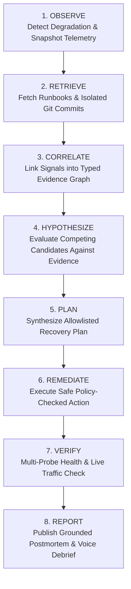

# ChaosPilot 🚀
### Agentic Multimodal SRE Agent for Autonomous Incident Diagnosis & Safe Recovery

> **Hackathon Theme:** *"The Agentic Era: Supercharging RAG with Vision and Voice"*  
> **Core Architecture:** Real 3-Tier FastAPI Microservices · SQLite WAL Telemetry · BM25 Grounded RAG · Isolated Git Change Analysis · Multimodal Perception (Voice STT/TTS & Structural Vision) · Directional Evidence Graph · Empirical Verification Loop

---

## 1. The Problem: The SRE Diagnostic & Recovery Crisis
During complex distributed systems outages, on-call Site Reliability Engineers (SREs) face cognitive overload:
* **Information Fragmentation:** Critical signals are scattered across raw metric streams, distributed traces, siloed runbook wikis, recent commit histories, and monitoring dashboard screenshots.
* **Alert Fatigue & Propagation Delays:** Upstream errors (e.g., Gateway `504 Gateway Timeout`) often disguise the true root cause residing deep in downstream dependencies.
* **High Mean Time to Recovery (MTTR):** Human operators must manually correlate time-series anomalies with runbook remediation steps, formulate hypotheses, risk execute mitigation commands, and verify recovery.
* **The "Naive AI" Fallacy:** Generic LLM chatbots fabricate operational advice, hallucinate non-existent runbook commands, lack empirical grounding, and cannot safely interact with or verify real production infrastructure.

---

## 2. Why ChaosPilot?
ChaosPilot is an autonomous, evidence-grounded SRE agent built from first principles for deterministic, verifiable reliability operations.

| Dimension | Naive LLM Chatbot / Copilot | Traditional Runbook Automation | ChaosPilot Multimodal SRE Agent |
| :--- | :--- | :--- | :--- |
| **Grounding** | Unbounded hallucination, fake confidence | None (Static hardcoded scripts) | **Strict Empirical Provenance (Telemetry, Docs, Git)** |
| **Multimodality** | Text prompt only | None | **Voice STT/TTS + Visual Topology & Dashboard Analysis** |
| **Root Cause Analysis** | Speculative text generation | Brittle conditional trees | **Directional Evidence Graph & Grounded Claims Engine** |
| **Remediation Safety** | Arbitrary shell or hallucinated commands | Unverified blind scripts | **Zero-Trust Allowlisted SRE Tools & Policy Engine** |
| **Resolution Guarantee** | Assumes recovery if prompt succeeds | Exit code checks | **Empirical Closed-Loop Multi-Probe Verification** |

---

## 3. Real 3-Tier Architecture & Tech Stack
ChaosPilot operates on real, running local services without simulated mocks or cloud dependencies.

```
                    +------------------------------------+
                    |        Operator Interface          |
                    |   Streamlit Console / Voice / CLI  |
                    +-----------------+------------------+
                                      |
                                      v
                    +------------------------------------+
                    |     ChaosPilot Agentic Core        |
                    |  Observe -> Retrieve -> Correlate  |
                    |  Hypothesize -> Plan -> Verify     |
                    +---+--------------+--------------+--+
                        |              |              |
         +--------------+              |              +---------------+
         |                             |                              |
         v                             v                              v
+-----------------+           +-----------------+            +-----------------+
|  Multimodal RAG |           |  Evidence Graph |            | SRE Tool & Safety|
| - BM25 Runbooks |           | - Typed Nodes   |            | - Allowlist      |
| - Isolated Git  |           | - Provenance    |            | - Policy Engine  |
| - Voice STT/TTS |           | - Grounded      |            | - Process        |
| - Vision Insp.  |           |   Claims        |            |   Sandbox        |
+-----------------+           +-----------------+            +-----------------+
                                       |
                                       v
         =================== Target Environment ===================
         [Gateway :8000] ----> [Order Service :8001] ----> [Payment Service :8002]
                |                      |                            |
                +----------------------+----------------------------+
                                       | Real Request Latency / Status
                                       v
                           [SQLite WAL Telemetry DB]
```

### Technology Stack
* **Microservices:** Python 3.12, FastAPI, Uvicorn, HTTPX
* **Telemetry Storage:** SQLite (WAL mode, busy timeouts, structured schema)
* **Knowledge Retrieval (RAG):** Rank-BM25 with section-preserving Markdown parsing
* **Git Forensics:** GitPython (strictly isolated to ChaosPilot workspace)
* **Voice STT & TTS:** Google Web Speech Recognition (speech_recognition), gTTS, pydub, static-ffmpeg
* **Visual Perception:** Pillow image analysis, local structural topology inspection, optional Google GenAI SDK fallback
* **Operator Console:** Streamlit with live reactive timeline and 6 diagnostic inspection tabs
* **Testing & Verification:** Pytest, AnyIO, AsyncIO (117 automated regression tests)

---

## 4. Deterministic Fault Scenario
ChaosPilot models a classic microservice cascading failure:
1. **Target Topology:** API Gateway (`:8000`) -> Order Service (`:8001`) -> Payment Service (`:8002`).
2. **Nominal State:** Checkout calls traverse the chain within ~80ms SLA. Gateway responds `200 OK`.
3. **Controlled Fault Injection:** A controlled artificial processing delay of 4.5 seconds is injected into `Payment Service` via `/fault/inject`.
4. **Failure Propagation:**
   - Order Service upstream timeout is 2.5s.
   - Gateway upstream timeout is 3.0s.
   - When Payment Service delays 4.5s, Order Service and Gateway exceed their timeout budgets, triggering cascaded `504 Gateway Timeout` errors.
   - Gateway metrics record a 100% error rate; Payment Service records active timeout faults; Order Service remains healthy but blocked.

---

## 5. Explicit 8-Phase SRE Investigation & Recovery Workflow
ChaosPilot strictly rejects black-box decision making. Every incident follows an 8-phase verifiable lifecycle:



1. **Observe:** Captures atomic snapshot from real telemetry DB and service `/health` endpoints.
2. **Retrieve:** Queries local operational runbooks (`knowledge/runbooks/`) via BM25 and inspects recent Git commits.
3. **Correlate:** Synthesizes observations into typed evidence nodes and correlates failure paths.
4. **Hypothesize:** Evaluates competing diagnostic hypotheses (`payment_timeout`, `order_service_crash`, `gateway_misconfig`, `nominal_health`).
5. **Plan:** Validates required recovery tools against allowlists and safety policies.
6. **Remediate:** Invokes safe mitigation (e.g., `reset_controlled_fault` on Payment Service).
7. **Verify:** Dispatches empirical probes (HTTP status, fault state, and live traffic burst).
8. **Report:** Generates an explainable postmortem report with citation IDs and verbal debrief.

---

## 6. Evidence Graph & Grounded Claims
To eliminate LLM hallucination and ensure auditability, ChaosPilot builds an explicit in-memory **Evidence Graph**:
* **Nodes:** Services, Incidents, Telemetry metrics, Runbook documents, Git commits, Visual observations, Voice inputs, Hypotheses, Actions, and Grounded Claims.
* **Edges:** Typed relationships (`observed_on`, `propagates_to`, `documented_by`, `changed_by`, `supported_by`, `contradicted_by`, `acted_on`, `verified_by`).

### Claim Support Classification Invariants
Every diagnostic claim is evaluated across 5 qualitative support categories:
* **Case A (Unsupported):** 0 empirical evidence items -> `unsupported` (Status: `candidate`).
* **Case B (Weakly Supported):** 1 valid evidence item -> `weakly_supported` (Status: `candidate`).
* **Case C (Supported):** $\ge 2$ evidence items in the same modality -> `supported` (Status: `confirmed`).
* **Case D (Strongly Supported):** $\ge 3$ items across $\ge 2$ distinct modalities with 0 contradictions -> `strongly_supported` (Status: `confirmed`).
* **Case E (Contradicted):** $\ge 1$ empirical contradiction -> `contradicted` (Status: `refuted`).

---

## 7. Multimodal Perception Model
ChaosPilot natively integrates Voice and Vision into the SRE diagnostic loop:
* **Voice STT (Speech-to-Text):** Transcribes operator directives (e.g., *"Investigate checkout timeouts"*) into structured text citations using SpeechRecognition.
* **Voice TTS (Text-to-Speech):** Synthesizes natural spoken incident debriefs for on-call engineers using gTTS and pydub.
* **Visual Topology & Dashboard Inspection:**
  - Automatically renders system topology diagrams and live telemetry percentiles using Matplotlib.
  - Inspects dashboard artifacts using Pillow structural inspection (resolutions, file integrity, and visual component graphs).
  - Falls back cleanly with clear status indicators when cloud vision API credentials (Gemini) are absent. Never manufactures fake vision analysis.

---

## 8. Safety Model & Zero-Trust Tool Execution
ChaosPilot adheres to strict zero-trust SRE safety invariants:
* **Zero Arbitrary Execution:** No `shell=True`, no `os.system`, no arbitrary bash/powershell strings, and no dynamic `eval`/`exec`.
* **Allowlisted Tools Only:** Actions are restricted to pre-registered tools (`inspect_health`, `inspect_metrics`, `inspect_recent_logs`, `inspect_fault_state`, `retrieve_runbook`, `inspect_git_changes`, `probe_traffic`, `restart_service`, `reset_controlled_fault`).
* **Target Allowlist:** Service targets must be members of `ALLOWED_SERVICES` (`{"gateway", "order-service", "payment-service"}`).
* **Policy Engine:** Recovery actions are blocked unless the incident is in the `remediation` phase and backed by a confirmed hypothesis.
* **The Resolution Invariant:** The console and metrics will **NEVER** display or record `RESOLVED` unless empirical verification passes (`report.final_status == "resolved"` AND `verification_results[-1].status == "verified_recovered"`).

---

## 9. Evaluation Framework & Progressive Baselines
ChaosPilot includes an objective, empirical evaluation benchmark comparing 4 progressive architectural configurations on a controlled incident scenario:

```
### ChaosPilot Evaluation Matrix (Synthetic Controlled Benchmark)
Fixture ID: benchmark_payment_timeout_propagation | Incident Type: timeout_propagation
```

| Metric | Config A (Retrieval Only) | Config B (RAG + Reasoning) | Config C (Agentic RAG + Verify) | Config D (Multimodal Graph + Verify) |
| :--- | :---: | :---: | :---: | :---: |
| **Retrieval Recall@3** | 100.0% | 100.0% | 100.0% | 100.0% |
| **Hypothesis Correctness** | ❌ FAIL | ✅ PASS | ✅ PASS | ✅ PASS |
| **Safe Action Executed** | ❌ NO | ❌ NO | ✅ YES | ✅ YES |
| **Empirical Verification** | ❌ NO | ❌ NO | ✅ PASS | ✅ PASS |
| **Trace Completeness** | 0.0% | 0.0% | 100.0% | 100.0% |
| **Evidence Graph Nodes** | 0 | 0 | 0 | 24 |
| **Final Status** | `unresolved` | `investigated_unresolved` | `resolved` | `resolved` |

* **Config A (Retrieval Only):** Retrieves runbooks via BM25, but cannot diagnose hypotheses or remediate.
* **Config B (RAG + Reasoning):** Correctly diagnoses root cause, but performs no remediation and cannot verify restoration.
* **Config C (Agentic RAG + Verification):** Diagnoses, remediates using allowlisted tools, and verifies restoration.
* **Config D (Full Multimodal Graph):** Adds multi-tier provenance, linking telemetry, runbooks, git, visual topology, and grounded claims into a complete verifiable graph.

---

## 10. Quickstart & Demo Instructions

### 1. Run Complete Automated Incident Demo (CLI)
Simulates baseline traffic, injects a controlled timeout, generates incident traffic, and triggers ChaosPilot autonomous diagnosis and verified recovery:
```powershell
python manage.py agent-incident --count 6
```

### 2. Run Progressive Baseline Evaluation
Executes the evaluation framework comparing Configs A through D:
```powershell
python manage.py evaluate
```

### 3. Launch the Multimodal Operator Console
Launches the interactive Streamlit SRE console:
```powershell
python manage.py console
# OR
streamlit run app/streamlit_app.py
```

### 4. Run Full Regression Test Suite
Executes all 117 automated unit and integration tests across Stages 1–8:
```powershell
pytest -v
```

---

## 11. Installation & Environment Setup
ChaosPilot runs locally on Windows, macOS, or Linux using standard Python 3.12. **Docker is completely optional.**

```powershell
# Clone or navigate to the workspace
cd C:\Users\VAJAYA\Desktop\RAG

# Ensure dependencies are installed
pip install -r requirements.txt

# Verify service status
python manage.py status
```

---

## 12. Project Structure & Codebase Navigation
```
RAG/
├── agent/                   # Agentic Reasoning Core
│   ├── models.py            # Typed domain entities (IncidentState, Report, Hypotheses)
│   ├── evidence.py          # Multimodal evidence correlation engine
│   ├── hypotheses.py        # Candidate hypothesis generation & evaluation
│   ├── policy.py            # Zero-trust safety policy engine
│   ├── planner.py           # Allowlisted tool planning
│   ├── executor.py          # Safe action execution wrapper
│   ├── verifier.py          # Empirical post-recovery multi-probe verification
│   ├── reasoning.py         # Deterministic & optional Gemini reasoning backends
│   ├── evidence_graph.py    # Directional Evidence Graph & Grounded Claims engine
│   ├── tools.py             # Authorized SRE inspection and remediation tools
│   └── orchestrator.py      # End-to-end incident response lifecycle coordinator
├── app/                     # Operator UI
│   └── streamlit_app.py     # Multimodal SRE Operator Console (6 tabs)
├── evaluation/              # Quantitative Evaluation Benchmark
│   ├── benchmarks.py        # Controlled benchmark fixtures & ground truth
│   ├── metrics.py           # Mathematical evaluation metrics (Recall, Precision, MRR)
│   └── framework.py         # Progressive baseline evaluation matrix (Configs A-D)
├── git_ops/                 # Isolated Git Change Analysis
│   └── diff_analyzer.py     # Read-only Git forensics within project workspace
├── knowledge/               # Grounded Knowledge Base
│   ├── runbooks/            # Operational runbooks (payment, order, gateway)
│   └── architecture/        # Service topology and budget specifications
├── multimodal/              # Multimodal Perception Layer
│   ├── schema.py            # Multimodal evidence containers & schemas
│   ├── voice_transcriber.py # Speech-to-Text transcription (Google Web Speech)
│   ├── voice_synthesizer.py # Text-to-Speech audio synthesis (gTTS)
│   ├── vision_inspector.py  # Structural & semantic vision inspection
│   └── visualizer.py        # Automated topology and telemetry diagram generators
├── sandbox/                 # Local Process Target Environment
│   └── process_sandbox.py   # Windows-safe subprocess lifecycle management
├── services/                # Real 3-Tier FastAPI Microservices
│   ├── gateway.py           # API Gateway (:8000)
│   ├── order_service.py     # Order Service (:8001)
│   ├── payment_service.py   # Payment Service (:8002) with controlled fault injection
│   └── config.py            # Shared ports, URLs, and directory configurations
├── telemetry/               # Real Telemetry Layer
│   ├── db.py                # SQLite WAL telemetry store & aggregations
│   ├── middleware.py        # FastAPI request telemetry capture middleware
│   ├── traffic.py           # Real bounded synthetic traffic generator
│   └── snapshot.py          # Atomic incident snapshot serializer
├── tests/                   # Comprehensive Test Suite (Stages 1-8)
│   ├── test_stage1.py ... test_stage8.py (117 tests passing)
├── docs/                    # Architectural Specifications & Demo Guides
├── manage.py                # Unified CLI entrypoint
└── requirements.txt         # Pinned project dependencies
```

---

## 13. Limitations & Disclosures
* **Controlled Benchmark:** Evaluation results are measured against a deterministic 3-tier microservice sandbox scenario (Payment timeout propagation). They reflect real system behavior on this topology, not external multi-tenant production traffic.
* **Cloud Vision Fallback:** When `GEMINI_API_KEY` is not present in the environment, semantic vision falls back cleanly to local structural inspection. ChaosPilot never fakes semantic understanding.
* **Process Sandbox:** Uses native OS subprocesses for local execution. Docker containers are supported architecturally but not required for evaluation.

---

## 14. Future Work & Production Roadmap
1. **eBPF Kernel Probing:** Extend telemetry collection from application middleware to kernel-level socket latency tracking.
2. **Kubernetes CRD Operator:** Package ChaosPilot as a Kubernetes Custom Resource Operator for automated pod mitigation.
3. **Multi-Agent Swarm:** Deploy specialized sub-agents for concurrent database tracing, cloud network analysis, and runbook drafting.
4. **Real-Time WebRTC Streaming:** Enable continuous two-way audio streaming for hands-free live incident bridge collaboration.
