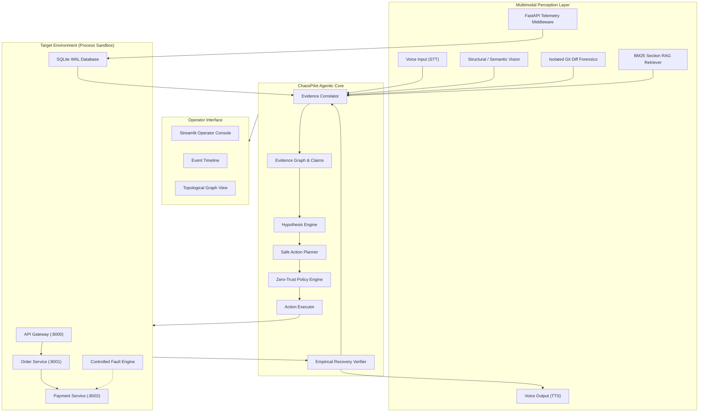

# ChaosPilot System Architecture Specification
### Final Technical Architecture & Trust Boundary Model (Project Freeze)

---

## 1. High-Level Architectural Overview

ChaosPilot is an autonomous, evidence-grounded Multimodal Site Reliability Engineering (SRE) agent designed to diagnose, remediate, and verify incidents across distributed microservice architectures.

---

## 2. Trust Boundaries & Security Architecture

ChaosPilot implements a defense-in-depth security perimeter to guarantee that autonomous AI operations cannot compromise the host environment or execute arbitrary code.

```mermaid
flowchart LR
    subgraph UntrustedZone["Untrusted / External Input Zone"]
        OperatorVoice["Operator Audio Directives"]
        OperatorText["Operator Text Prompts"]
        VisualImages["Dashboard Screenshots"]
    end

    subgraph AIReasoningZone["AI Reasoning Zone (Constrained Output)"]
        LLMBackend["Reasoning Engine (Deterministic / Gemini)"]
        Hypotheses["Candidate Hypotheses"]
        ProposedPlans["Proposed Action Plans"]
    end

    subgraph SecurityGate["Zero-Trust Security Perimeter"]
        ToolAllowlist["Tool Registry Allowlist"]
        PolicyEngine["Policy Engine Validator"]
        ArgSanitizer["Service & Argument Sanitizer"]
    end

    subgraph ExecutionZone["Isolated Execution Zone"]
        ProcessSandbox["Process Sandbox Subprocesses"]
        AllowlistedTools["Explicit Allowlisted SRE Tools"]
        TargetServices["Target Microservices (:8000-:8002)"]
    end

    UntrustedZone --> AIReasoningZone
    AIReasoningZone -->|PlannedAction Struct| SecurityGate
    SecurityGate -- REJECT Unregistered / Shell / Rogue Targets --> ErrorHalt["Halt & Report Violation"]
    SecurityGate -- AUTHORIZE Valid Action --> AllowlistedTools
    AllowlistedTools --> ExecutionZone
```

### Trust Boundary Invariants
1. **Zero Shell Execution:** No tool implementation utilizes `shell=True`, `subprocess.call(..., shell=True)`, `os.system()`, or runtime code evaluation (`eval()`, `exec()`).
2. **Strict Tool Whitelisting:** All executable capabilities are declared as static `ToolDefinition` dataclasses inside `agent/tools.py`. If a tool name does not match the registry, execution is halted immediately.
3. **Target Restriction:** Network and process operations are restricted to `ALLOWED_SERVICES` (`{"gateway", "order-service", "payment-service"}`).
4. **Git Workspace Isolation:** The Git analyzer validates that `repo.working_tree_dir` strictly equals the ChaosPilot root (`C:\Users\VAJAYA\Desktop\RAG`). Parent directory traversal is explicitly disabled (`search_parent_directories=False`).
5. **Phase-Gated Remediation:** Recovery actions are rejected unless the incident lifecycle has progressed through `Detection`, `Investigation`, and `Hypothesis Generation` to the `Remediation` phase with a confirmed hypothesis.

---

## 3. Deep Component Breakdown

### 3.1 Target Environment & Sandbox (`sandbox/`, `services/`)
* **Gateway (:8000):** Exposes `/checkout`, `/health`, and `/metrics`. Routes checkout calls to Order Service with an upstream timeout budget of 3.0s.
* **Order Service (:8001):** Validates inventory and calls Payment Service with an upstream timeout budget of 2.5s.
* **Payment Service (:8002):** Executes transactions. Hosts `/fault/inject`, `/fault/reset`, and `/fault/status` endpoints to introduce controlled artificial delays and HTTP error codes.
* **ProcessTargetEnvironment:** Manages native OS subprocesses, tracks PIDs, and prevents zombie process leakage on Windows.

### 3.2 Real Telemetry & Bounded Traffic (`telemetry/`)
* **SQLite WAL DB:** Ingests granular request timings, HTTP statuses, and error counts. Uses write-ahead logging (WAL) and busy timeout handlers to avoid database lock contention.
* **Traffic Generator:** Sends bounded bursts with deterministic concurrency and inter-request pacing.
* **Snapshot Engine:** Captures point-in-time serialized health, fault status, and aggregated service metrics.

### 3.3 Grounded Knowledge & Git Forensics (`rag/`, `git_ops/`)
* **Document Indexer:** Chunks Markdown runbooks preserving headers and operational sections.
* **BM25 Retriever:** Performs keyword-grounded retrieval without hallucination. Returns structured `RunbookCitation` objects with exact document and section provenance.
* **Git Diff Analyzer:** Extracts commits, authors, and unified diff patches touching service paths. Never mutates Git state.

### 3.4 Multimodal Perception (`multimodal/`)
* **Voice STT:** Transcribes speech commands to text citations using Google Web Speech Recognition.
* **Voice TTS:** Generates verbal postmortem summaries using gTTS.
* **Vision Inspector:** Structural validation of topology diagrams and metrics dashboards using Pillow. Detects format, dimensions, component boundaries, and cleanly degrades when Gemini API keys are absent.

### 3.5 Agentic Incident Reasoning Core (`agent/`)
* **Evidence Correlator:** Maps multimodal inputs into standardized `MultimodalEvidenceItem` entities.
* **Hypothesis Engine:** Formulates testable failure models and tracks supporting vs. contradicting evidence.
* **Policy Engine:** Enforces safe phase progression and verifies action targets.
* **Action Planner & Executor:** Creates minimal, safe remediation steps and executes them through allowlisted handlers.
* **Recovery Verifier:** Empirically probes `/health`, `/fault/status`, and live traffic before declaring recovery.

### 3.6 Evidence Graph & Grounded Claims (`agent/evidence_graph.py`)
* Constructs directional graph linking observations, documents, commits, claims, actions, and verifications.
* Strictly evaluates claims into 5 qualitative support categories (Unsupported, Weakly Supported, Supported, Strongly Supported, Contradicted).
* Exports valid Mermaid flowcharts for operator visualization.

---

## 4. Failure Modes & Graceful Degradation Matrix

| Failure Mode | Agent Behavior | Fallback / Safeguard |
| :--- | :--- | :--- |
| **Gemini API Key Missing** | Logs status as unavailable | Degrades cleanly to deterministic rule-based reasoning and local structural vision |
| **Target Service Down** | Probes return `down` or `timeout` | Records telemetry evidence; plans restart action via sandbox |
| **Docker Unavailable** | Subprocess sandbox takes priority | Zero Docker requirement; operates natively on host OS |
| **Microphone Absent** | STT recorder hidden | Text input directive field remains available in console |
| **TTS Synthesis Failure** | Status marked `unavailable` | Text debrief displayed in UI; no crash |
| **Git Working Tree Dirty** | Read-only inspection continues | Never modifies working tree; logs warnings |
| **Verification Fails** | Resolution blocked | Status marked `unresolved`; alert surfaced to operator |
