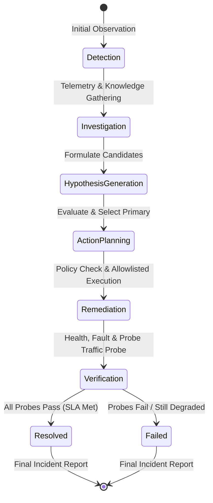

# ChaosPilot — Stage 5: Agentic Incident Reasoning Core

## 1. Overview

Stage 5 transforms ChaosPilot from a collection of isolated perception and telemetry tools into a controlled, explainable SRE incident response agent.

The agent follows an explicit, deterministic operational loop:

$$\text{OBSERVE} \longrightarrow \text{RETRIEVE} \longrightarrow \text{CORRELATE} \longrightarrow \text{HYPOTHESIZE} \longrightarrow \text{PLAN} \longrightarrow \text{EXECUTE} \longrightarrow \text{VERIFY} \longrightarrow \text{REPORT}$$

### Fundamental Principles
1. **Real Evidence First:** All decisions originate from empirical telemetry, knowledge base runbooks, isolated git commits, and verified perception artifacts.
2. **Zero Shell Execution:** Absolutely no arbitrary shell commands (`shell=True`, `os.system`, `eval`, `exec`, PowerShell/cmd strings). The agent may only invoke pre-registered Python functions guarded by strict allowlists.
3. **No Black-Box "Magic AI":** No hallucinated probabilities or unverified claims of "AI fixed the issue." Hypotheses use qualitative confidence (`low`, `medium`, `high`), and recovery is declared **only** after empirical before/after probe verification.

---

## 2. Agent Architecture & State Machine

The agent lifecycle is orchestrated by `IncidentOrchestrator` (`agent/orchestrator.py`) maintaining explicit state transitions in `IncidentState`:



### Incident Phases
- `detection`: Identifies anomalous signals from live target health and telemetry snapshots.
- `investigation`: Gathers granular telemetry metrics, retrieves runbooks and architecture docs from RAG, and queries isolated Git diffs.
- `hypothesis_generation`: Formulates and evaluates candidate hypotheses against evidence items.
- `action_planning`: Formulates an ordered sequence of safe, allowlisted recovery actions.
- `remediation`: Dispatches actions through the safety policy engine to the tool executor.
- `verification`: Performs empirical before/after comparison via active probe traffic.
- `resolved` / `failed`: Emits an explainable postmortem report with cited evidence.

---

## 3. Evidence Correlation Model

`EvidenceCorrelator` (`agent/evidence.py`) processes incoming telemetry and knowledge into typed `MultimodalEvidenceItem` instances:
- **Telemetry Evidence:**
  - Health checks: `health_probe:<source>`
  - Metrics summaries: `metrics_summary:<service>@logs/telemetry.db`
  - Fault status: `http://127.0.0.1:8002/fault/status`
- **Knowledge Evidence (RAG):**
  - Chunk snippets from `knowledge/runbooks/` and `knowledge/architecture/` with section provenance and similarity scores.
- **Git History Evidence:**
  - Historical commits and diff patches from the isolated local repository matching diagnostic terms.

---

## 4. Structured Hypothesis Engine

`HypothesisEngine` (`agent/hypotheses.py`) evaluates candidate failure explanations without arbitrary fabricated probabilities:

| Hypothesis ID | Statement | Typical Supporting Evidence |
| :--- | :--- | :--- |
| `hyp_payment_timeout_budget_exceeded` | Payment processing delay exceeded upstream timeout budget, causing Payment failures and propagated Gateway 504 responses. | Payment fault active, Payment latency $>2.0$s, Gateway 504 count $>0$, `payment_timeout.md` SLA chunk. |
| `hyp_order_service_failure` | Order Service crashed, unresponsive, or experiencing unhandled internal server errors. | Order Service health $\ne$ healthy, process unreachable. |
| `hyp_gateway_routing_failure` | API Gateway routing misconfiguration or internal client timeout budget mismatch. | Gateway health $\ne$ healthy, ingress 404/502. |
| `hyp_nominal_system_health` | All microservices are operating nominally within SLA thresholds; no active incident. | All services 200 OK, zero errors recorded in telemetry window. |

### Confidence Ratings
- **High:** Backed by direct active fault confirmation and matching telemetry error patterns.
- **Medium:** Backed by status code distributions and runbook failure signatures.
- **Low:** Candidate or unverified state without conclusive metrics.

---

## 5. Tool Registry & Security Allowlist

All actions execute through `ToolRegistry` (`agent/tools.py`). 

### Registered SRE Tools
1. `inspect_health(service)`: Read-only inspection of service `/health` endpoints.
2. `inspect_metrics(service, window_seconds)`: Read-only query against SQLite WAL metrics.
3. `inspect_recent_logs(service, lines)`: Read-only tail of stdout/stderr logs.
4. `inspect_fault_state()`: Read-only query of Payment Service `/fault/status`.
5. `retrieve_runbook(query, top_k)`: Read-only lexical search for operational runbooks.
6. `retrieve_architecture(query, top_k)`: Read-only search for topology and SLA budgets.
7. `inspect_git_changes(query_terms, limit)`: Read-only search for isolated commits.
8. `probe_traffic(count, concurrency)`: Read-only bounded probe traffic burst to Gateway.
9. `restart_service(service)`: Controlled recovery restarting an allowlisted process.
10. `reset_controlled_fault()`: Controlled recovery resetting Payment Service artificial delay.

### Security Allowlist
- Only `gateway`, `order-service`, and `payment-service` may be targeted.
- Any attempt to execute unauthorized tools or pass arbitrary shell strings immediately raises `ToolSecurityError`.

---

## 6. Safe Policy Engine & "Read-Only First"

`PolicyEngine` (`agent/policy.py`) enforces strict separation of concerns:
- **Investigation / Detection Phase:** Only `read_only=True` tools are permitted. No recovery actions may run during investigation.
- **Remediation Phase:** Recovery actions require an evaluated and supported primary hypothesis.
- **Target Restriction:** Targets must strictly belong to `ALLOWED_SERVICES`. Unsafe targets (e.g. `postgres`, `system`, arbitrary daemons) are permanently blocked.

---

## 7. Verification Loop & Before/After Comparison

`RecoveryVerifier` (`agent/verifier.py`) prevents premature declaration of recovery:

```
Recovery Action Executed
         ↓
Stabilization Wait (1.0s)
         ↓
Live Health Probes (Gateway, Order, Payment)
         ↓
Fault State Clearance Probe
         ↓
Active Probe Traffic Burst (4 requests to Gateway)
         ↓
Before vs. After Comparison
         ↓
Verification Status Assigned
```

### Possible Verification States
- `verified_recovered`: All health checks 200 OK, fault cleared, probe traffic 100% successful, average latency within SLA ($<1200$ms).
- `partially_recovered`: Health checks pass, but probe traffic experiences dropped requests or timeouts.
- `still_failing`: Services remain degraded or probe traffic fails completely.
- `verification_failed`: Unexpected exception or unhandled probe error.

---

## 8. CLI Usage

```bash
# Run read-only SRE agent investigation on the current environment:
python manage.py agent-investigate

# Run complete real controlled incident simulation, diagnosis, and verified recovery:
python manage.py agent-incident --count 6
```

---

## 9. Known Limitations

1. **Local Sandbox Scope:** Operations target the local 3-tier FastAPI environment managed by `ProcessTargetEnvironment`.
2. **Zero Shell Execution:** No shell commands or arbitrary external scripts can be run by the agent.
3. **Deterministic Reasoning Core:** An optional Gemini adapter is included, but default operation is 100% deterministic and requires no external API keys or network connection for reasoning.
