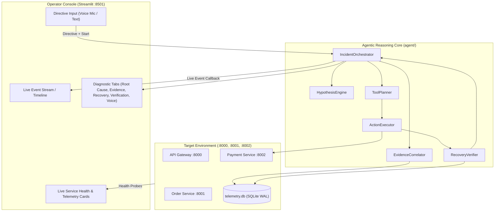

# ChaosPilot — Stage 6: Multimodal SRE Operator Console

## 1. Executive Summary

Stage 6 integrates the entire ChaosPilot autonomous SRE pipeline—from target microservices, telemetry, grounded RAG, isolated Git evidence, multimodal perception (vision & voice), and agentic reasoning—into a unified **Multimodal Operator Console**.

The console provides a real-time, zero-trust SRE operations cockpit that allows human SRE engineers to interact with ChaosPilot through either voice or text directives, observe the live event timeline of the autonomous agent, inspect multimodal evidence across five modalities, review empirical before-and-after verification metrics, and listen to a spoken audio debrief.

All interactions strictly preserve single-source-of-truth semantics: the UI directly delegates to `agent/orchestrator.py:IncidentOrchestrator` without replicating agent decision logic or fabricating state.

---

## 2. Architecture & Design Principles



### Key Architectural Invariants:
1. **Single Source of Truth**: The console does not duplicate or mock agent reasoning. It instantiates `IncidentOrchestrator` and subscribes to structured lifecycle events via an event callback pattern (`_emit(...)`).
2. **Zero Fabrication**:
   - Voice transcriptions from `VoiceTranscriber` reflect actual audio data; invalid audio outputs errors or empty strings, never invented text.
   - Evidence tabs display genuine citations from SQLite telemetry, markdown runbooks, and isolated project commits.
   - If vision models (Gemini) are unconfigured, visual tabs display structural image metadata and clearly indicate that semantic AI inspection is unavailable.
3. **Strict Resolution Invariant**: The UI is architecturally forbidden from displaying `RESOLVED` unless `report.final_status == "resolved"` **AND** empirical before/after verification checks pass (`VerificationStatus.VERIFIED_RECOVERED`).
4. **Zero Arbitrary Shell Execution**: Zero occurrences of `shell=True`, `os.system()`, `eval()`, or `exec()`. Recovery operations are restricted to allowlisted, parameterized tool handlers (`restart_service`, `reset_controlled_fault`).

---

## 3. Operator Console Features

### 3.1. Live Target Health & Telemetry Cards
- **API Gateway (`:8000`)**, **Order Service (`:8001`)**, and **Payment Service (`:8002`)** status cards query live HTTP `/health` endpoints and the SQLite WAL database.
- Displays request count, error count, and P95 latency computed over a rolling 5-minute window.
- Visual badges: 🟢 `HEALTHY`, 🟠 `DEGRADED`, 🔴 `DOWN / TIMEOUT`.

### 3.2. Sandbox & Fault Injection Sidebar
- **Environment Controls**: Direct buttons to `Start All` or `Stop All` services.
- **Fault Injection Panel**: Allows setting fault mode (`timeout`, `500`, `503`) and artificial delay slider ($1.0\text{s} - 6.0\text{s}$), injecting controlled degradation directly into Payment Service.
- **Test Checkout Button**: Sends an immediate end-to-end checkout request through the Gateway and displays response code and latency in milliseconds.

### 3.3. Operator Directive (Voice STT + Text)
- **Voice Mic Input**: Uses `streamlit_mic_recorder` and `VoiceTranscriber.transcribe_bytes(...)` to transcribe real operator speech via Google Web Speech API.
- **Directive Text Input**: Allows typing or refining directives (e.g., *"Investigate payment timeout and restore service"*).
- Directives are stored in `IncidentState.directive`, emitted to the event timeline, and recorded in the audit trail.

### 3.4. Chronological Agent Timeline
Visual event feed capturing every transition in the agent lifecycle:
- 🎯 `DIRECTIVE`: Operator directive received.
- 🚨 `DETECTION`: Target degradation detected via health probe / snapshot.
- 🔎 `INVESTIGATION`: Multimodal evidence collection from SQLite WAL, RAG, and Git.
- 🧠 `HYPOTHESES`: Hypothesis generation and deterministic / Gemini reasoning.
- 📋 `PLANNING`: Safe remediation action planning.
- 🛠️ `REMEDIATION`: Execution of allowlisted recovery actions.
- 🔬 `VERIFICATION`: Empirical probing of health, fault state, and checkout traffic.
- ✅ `RESOLVED` / ❌ `FAILED`: Final verdict based on empirical verification.

### 3.5. Structured SRE Deep Diagnostic Tabs
1. **Root Cause Analysis**: Displays the grounded root cause, citing specific evidence IDs (`ev_tel_...`, `ev_rag_...`, `ev_git_...`), along with candidate hypotheses and qualitative confidence levels (`HIGH`, `MEDIUM`, `LOW`).
2. **Multimodal Evidence**: Five dedicated sub-tabs displaying:
   - *Telemetry*: Service health and request summaries from SQLite WAL.
   - *Runbooks (RAG)*: Exact matched text snippets from `runbooks/` and `architecture/`.
   - *Git History*: Isolated commit diffs from `C:\Users\VAJAYA\Desktop\RAG`.
   - *Visual Diagrams*: Dynamically generated Mermaid-based topology diagram and real Matplotlib telemetry charts.
   - *Voice*: Input audio format, transcription backend, and status.
3. **Actions & Recovery**: Planned actions versus executed action audit records (`tool_name`, `target`, `started_at`, `finished_at`, `status`, `output`).
4. **Before/After Verification**: Side-by-side comparative table showing pre-recovery degradation versus post-recovery nominal operation, alongside probe pass/fail results.
5. **Spoken Voice Debrief (TTS)**: Synthesizes a natural, concise spoken SRE summary using `VoiceSynthesizer` (gTTS) directly from verified report fields, with in-browser audio playback.

---

## 4. How to Run

### Option A: Launching via Management CLI (Recommended)
```bash
python manage.py console
```
This launches Streamlit on `http://localhost:8501` with headless server configuration.

### Option B: Launching Directly with Streamlit
```bash
streamlit run app/streamlit_app.py
```

### Option C: Running the Full Incident Simulation via CLI
```bash
python manage.py agent-incident --count 6
```

---

## 5. Verification & Test Suite

The Stage 6 test suite is located in `tests/test_stage6.py` and provides comprehensive verification of all 14 Stage 6 requirements:

| Test ID | Test Function | Purpose | Status |
|:---|:---|:---|:---:|
| 1 | `test_operator_console_imports_cleanly` | App and helper functions import cleanly without error | **PASSED** |
| 2 | `test_status_collection_uses_real_service_state` | Health and telemetry status queries reflect real sandbox state | **PASSED** |
| 3 | `test_operator_directive_passed_to_orchestrator` | Directive is recorded in state, observations, and timeline events | **PASSED** |
| 4 | `test_voice_transcript_is_not_fabricated` | Invalid/corrupted audio bytes never fabricate fake transcripts | **PASSED** |
| 5 | `test_agent_event_timeline_receives_real_events` | Live event callbacks deliver structured timeline events | **PASSED** |
| 6 | `test_multimodal_evidence_tabs_preserve_provenance` | All evidence items preserve modality, provenance, and source | **PASSED** |
| 7 | `test_root_cause_panel_displays_real_report` | Report root cause and citations map to real evidence | **PASSED** |
| 8 | `test_recovery_panel_displays_real_action_results` | Action results record full audit information | **PASSED** |
| 9 | `test_verification_panel_displays_real_verification` | Verification results contain before/after snapshots and checks | **PASSED** |
| 10 | `test_console_never_displays_resolved_if_verification_failed` | Strict invariant: UI rejects RESOLVED if verification failed | **PASSED** |
| 11 | `test_voice_debrief_failure_handled_gracefully` | TTS errors handle gracefully without crashing | **PASSED** |
| 12 | `test_vision_unavailable_state_displayed_honestly` | Vision inspector reports structural data honestly without fake LLM output | **PASSED** |
| 13 | `test_no_arbitrary_shell_execution_exposed` | Zero arbitrary shell execution across console and agent | **PASSED** |
| 14 | `test_all_previous_stages_remain_compatible` | Stages 1–5 core capabilities remain fully compatible | **PASSED** |

### Full Test Suite Regression (Stages 1 through 6):
```
======================= 75 passed, 2 warnings in 58.72s =======================
- Stage 1 (Microservices & Sandbox): 11/11 passed
- Stage 2 (Telemetry & Snapshots):    8/8 passed
- Stage 3 (RAG & Git Analysis):       14/14 passed
- Stage 4 (Multimodal Perception):   12/12 passed
- Stage 5 (Agentic Reasoning Core):  16/16 passed
- Stage 6 (Operator Console):        14/14 passed
Total: 75/75 passed (100% pass rate)
```

---

## 6. Known Limitations & Next Steps

1. **Microphone in Headless Remote Environments**: The browser-based microphone recorder requires standard browser WebAudio permissions (HTTPS or localhost). In headless non-browser environments, operator directives default to the text input box.
2. **Google Web Speech STT Dependency**: The STT backend uses SpeechRecognition's Google Web Speech API, which requires an active internet connection. If disconnected, transcription gracefully returns status `"unavailable"` or `"error"`.
3. **Optional Docker Containerization**: The system is designed to run natively on Windows Python 3.12 with process-level isolation (`ProcessTargetEnvironment`), while preserving the Docker adapter interface for containerized deployment in environments where Docker is available.
