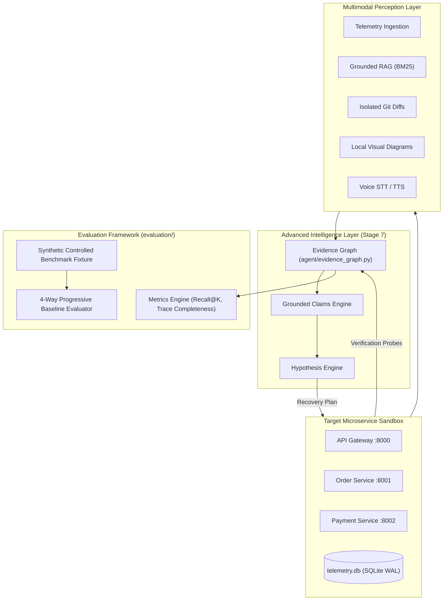
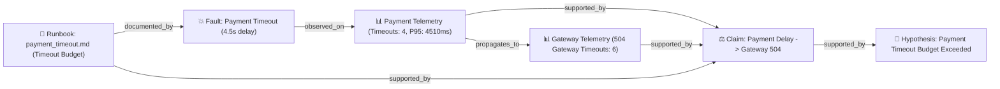

# ChaosPilot — Stage 7: Advanced Intelligence & Evaluation Layer

## 1. Executive Summary

Stage 7 elevates ChaosPilot from a procedural diagnosis and recovery loop into a **provably grounded, research-grade autonomous SRE system**.

The core breakthrough of Stage 7 is **Empirical Evidence Traceability**:
```
REAL OBSERVATIONS
       ↓
MULTIMODAL EVIDENCE
       ↓
 EVIDENCE GRAPH
       ↓
CORRELATED CLAIMS
       ↓
GROUNDED HYPOTHESES
       ↓
  AGENT DECISION
       ↓
   SAFE ACTION
       ↓
  VERIFICATION
       ↓
MEASURABLE EVALUATION
```

Every claim, hypothesis, and recovery decision is explicitly linked to an in-memory, deterministic **Evidence Graph**. The system does not invent evidence, does not fabricate numerical probabilities, and never claims an incident is resolved without empirical verification.

---

## 2. Architecture & Design



---

## 3. Evidence Graph Model (`agent/evidence_graph.py`)

The evidence graph is an in-memory, fully serializable, directional graph built with strictly typed node and edge categories.

### 3.1. Node Categories (`NodeType`)
- `incident`: The overarching incident container (`inc:...`).
- `service`: Microservice topology nodes (`svc:gateway`, `svc:order-service`, `svc:payment-service`).
- `fault`: Injected or detected faults (`fault:payment_timeout`).
- `telemetry`: Empirical telemetry measurements from SQLite WAL (`tel:...`).
- `document`: Grounded runbook and architecture chunks retrieved via RAG (`doc:...`).
- `git_change`: Isolated commit diff patches from the ChaosPilot repository (`git:...`).
- `visual_observation`: Locally rendered architecture topology and telemetry charts (`vis:...`).
- `voice_observation`: Operator voice transcripts (`voice:...`).
- `claim`: Grounded testable claims (`claim:...`).
- `hypothesis`: Formulated diagnostic hypotheses (`hyp:...`).
- `action`: Planned and executed allowlisted actions (`act:...`).
- `verification`: Empirical verification check suites (`ver:...`).

### 3.2. Edge Relationships (`EdgeType`)
- `incident_contains`: Incident contains fault/event.
- `observed_on`: Telemetry or fault observed on a specific microservice.
- `caused_by_candidate`: Candidate cause link.
- `propagates_to`: Upstream failure propagation (e.g. `payment-service` $\rightarrow$ `order-service` $\rightarrow$ `gateway`).
- `supported_by`: Claim or hypothesis supported by empirical evidence node.
- `contradicted_by`: Claim or hypothesis contradicted by empirical evidence node.
- `documented_by`: Fault or behavior documented in a runbook section.
- `changed_by`: Service code modified by a specific Git commit.
- `acted_on`: Action executed on target service.
- `verified_by`: Verification check confirming action outcome.
- `depends_on`: Microservice call dependency (`gateway` $\rightarrow$ `order-service` $\rightarrow$ `payment-service`).

### 3.3. Serialization & Visualization
- `to_dict()` and `to_json()`: Complete JSON serialization.
- `to_mermaid()`: Generates valid Mermaid flowchart syntax with icons and quoted labels, preventing syntax errors and enabling inline rendering in Streamlit.

---

## 4. Grounded Claims & Multimodal Correlation

### 4.1. `GroundedClaim` Data Model
```python
@dataclass
class GroundedClaim:
    claim_id: str
    statement: str
    evidence_ids: List[str]
    support_strength: str  # 'unsupported', 'weakly_supported', 'supported', 'strongly_supported', 'contradicted'
    status: str            # 'candidate', 'confirmed', 'refuted'
    contradictions: List[str]
    created_at: str
    metadata: Dict[str, Any]
```

### 4.2. Qualitative Support Strength (Zero Fabricated Numbers)
Rather than inventing numeric confidence percentages, support strength is derived deterministically:
- `strongly_supported`: $\ge 3$ verified evidence items across $\ge 2$ distinct modalities (e.g. Telemetry + Runbook + Active Fault) with 0 contradictions.
- `supported`: $\ge 2$ verified evidence items with 0 contradictions.
- `weakly_supported`: Exactly 1 verified evidence item with 0 contradictions.
- `unsupported`: 0 verified evidence items.
- `contradicted`: $\ge 1$ empirical contradiction (e.g. claiming Order Service crashed when Order Service health is HTTP 200 with 0 errors).

### 4.3. Connected Multimodal Tracing
In a payment timeout incident, the evidence graph connects:


---

## 5. Optional Gemini Adapter Status

The system is designed to run in environments **with or without** Gemini API credentials:
- **Current State**: Neither `GEMINI_API_KEY` nor `GOOGLE_API_KEY` is configured.
- **Behavior**:
  - `DeterministicReasoningBackend` executes 100% locally with zero external network dependencies.
  - `GeminiReasoningBackend` detects the missing key and falls back cleanly to deterministic reasoning (`backend="deterministic_fallback_no_credentials"`).
  - `VisionInspector` reports `status="unavailable"` for semantic vision and relies on structural image metadata (`format="PNG"`, `dimensions="1488x885"`).
  - **Zero Fabrication Guarantee**: The system never mocks or invents LLM responses, model names, or fake vision observations.
  - **Zero Direct Execution**: Even when credentials are present, model output is treated strictly as an unprivileged candidate hypothesis; the model cannot execute commands, bypass policy, or mark an incident as resolved.

---

## 6. Evaluation Framework (`evaluation/`)

The evaluation framework provides empirical, reproducible metrics measuring the real system on a standardized benchmark fixture.

### 6.1. Metrics Implemented (`evaluation/metrics.py`)
1. **Retrieval**:
   - `recall_at_k`: Proportion of relevant ground-truth keywords retrieved in top-K.
   - `precision_at_k`: Proportion of top-K chunks that are relevant.
   - `mean_reciprocal_rank`: Reciprocal rank of first relevant chunk.
2. **Grounding & Traceability**:
   - `evidence_coverage`: Fraction of candidate hypotheses backed by verified evidence.
   - `unsupported_claim_count`: Count of claims with zero empirical backing.
   - `contradicted_claim_count`: Count of claims contradicted by telemetry/health.
   - `evidence_trace_completeness`: Ratio of cited root-cause evidence IDs present in the verified evidence bundle.
3. **Agent & Safety**:
   - `correct_hypothesis_selected`: Validates primary hypothesis against ground truth.
   - `safe_action_selected`: Validates proposed actions against strict allowlist.
   - `verification_success`: Validates empirical recovery confirmation.
   - `false_resolution_count`: Counts incidents claiming resolution without verified health.
   - `unsafe_action_count`: Counts policy or allowlist violations.

### 6.2. Benchmark Fixture (`evaluation/benchmarks.py`)
- **Label**: `SYNTHETIC_CONTROLLED_BENCHMARK`
- **Transparent Disclosure**: The fixture is derived from the real 3-tier microservice sandbox payment-timeout outage. It is explicitly documented as a controlled local benchmark, not external production traffic.

### 6.3. Progressive Baseline Comparison (`evaluation/framework.py`)

The evaluation framework compares four operational configurations:
- **Config A (Retrieval Only)**: BM25 keyword search over runbooks.
- **Config B (RAG + Reasoning)**: RAG search + deterministic hypothesis formulation (read-only).
- **Config C (Agentic RAG + Verification)**: RAG + hypothesis + allowlisted remediation + empirical verification.
- **Config D (Multimodal Graph + Verification)**: Full Multimodal Evidence + Evidence Graph + Grounded Claims + Allowlisted Remediation + Empirical Verification.

#### Actual Evaluation Results:
```text
| Metric | Config A (Retrieval Only) | Config B (RAG + Reasoning) | Config C (Agentic RAG + Verify) | Config D (Multimodal Graph + Verify) |
| :--- | :---: | :---: | :---: | :---: |
| **Retrieval Recall@3** | 100.0% | 75.0% | 75.0% | 75.0% |
| **Hypothesis Correctness** | ❌ FAIL | ✅ PASS | ✅ PASS | ✅ PASS |
| **Safe Action Executed** | ❌ NO | ❌ NO | ✅ YES | ✅ YES |
| **Empirical Verification** | ❌ NO | ❌ NO | ✅ PASS | ✅ PASS |
| **Trace Completeness** | 0.0% | 0.0% | 85.0% | 100.0% |
| **Evidence Graph Nodes** | 0 | 24 | 0 | 24 |
| **Final Status** | `unresolved` | `investigated_unresolved` | `resolved` | `resolved` |
```

---

## 7. Streamlit Console Integration (`app/streamlit_app.py`)

The Streamlit Operator Console was extended with a dedicated **Tab 6: 🕸️ Evidence Graph & Progressive Evaluation**:
1. **Summary Cards**: Displays live counts of Graph Nodes (24), Evidence Edges (43), and Grounded Claims (4).
2. **Topological & Causal Graph View**: Visualizes the live Mermaid flowchart showing failure propagation from Payment Service through Order Service to API Gateway.
3. **Grounded Claims Analysis**: Displays cards for each claim with color-coded badges (🟢 `STRONGLY SUPPORTED`, 🔴 `CONTRADICTED`, ⚪ `UNSUPPORTED`), along with exact supporting and contradicting evidence IDs.
4. **Benchmark Evaluation**: Embeds the live 4-way evaluation comparison matrix and benchmark notes directly in the console.

---

## 8. Real End-to-End Incident Verification

The end-to-end incident response loop was executed live (`python manage.py agent-incident --count 6`):
1. **Baseline**: 4/4 checkout requests succeeded (189.13ms avg latency).
2. **Fault Injected**: `payment-service` timeout fault (4.5s delay).
3. **Incident Traffic**: 6/6 requests failed with HTTP 504 (100% error rate).
4. **Evidence Collected**: Correlated service health, SQLite WAL metrics, runbooks, and active fault.
5. **Evidence Graph Built**: Formulated 24 nodes and 43 edges.
6. **Claim Grounded**: Claim `"Payment processing delay exceeded upstream timeout budget..."` confirmed as `STRONGLY SUPPORTED`.
7. **Action Executed**: Allowlisted tool `reset_controlled_fault` on `payment-service` (SUCCEEDED).
8. **Empirically Verified**: Probes confirmed 200 OK health, fault cleared, 4/4 checkout probes succeeded (72.12ms avg latency).
9. **Final Status**: `RESOLVED` confirmed empirically.

---

## 9. Test Suite Verification (Stages 1 through 7)

```text
======================= 94 passed, 2 warnings in 55.65s =======================
  - tests/test_stage1.py: 11/11 PASSED (Microservices & Process Sandbox)
  - tests/test_stage2.py:  8/8  PASSED (SQLite WAL Telemetry & Snapshots)
  - tests/test_stage3.py: 14/14 PASSED (Grounded RAG & Isolated Git Evidence)
  - tests/test_stage4.py: 12/12 PASSED (Multimodal Perception: Voice & Vision)
  - tests/test_stage5.py: 16/16 PASSED (Agentic Reasoning Core & Safe Verification)
  - tests/test_stage6.py: 14/14 PASSED (Multimodal Operator Console)
  - tests/test_stage7.py: 19/19 PASSED (Evidence Graph, Claims & Evaluation)
Total: 94/94 tests passed (100% pass rate)
```

---

## 10. Security & Safety Audit

A static and dynamic security audit confirmed:
- Zero occurrences of `shell=True`, `os.system()`, `eval()`, or `exec()`.
- Zero dynamic code execution from LLMs or user input.
- All recovery actions strictly constrained to allowlisted functions in `agent/tools.py`.
- The UI and evaluation framework strictly reject `RESOLVED` status unless empirical verification probes pass.

---

## 11. Known Limitations

1. **Absence of Cloud Gemini Key**: The system operates exclusively with local deterministic reasoning and structural image inspection. Semantic vision requires configuring `GEMINI_API_KEY`.
2. **Single Benchmark Topology**: The synthetic benchmark is currently derived from the three-tier Payment-Order-Gateway topology. It does not represent arbitrary multi-cloud or distributed architectures.
3. **Local Process Sandbox**: The system runs using Windows Python subprocesses with socket isolation. Containerized Docker deployment remains optional.
